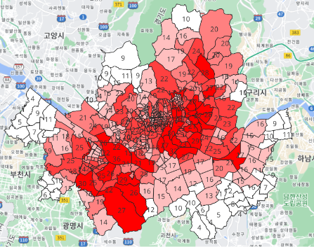

# 🪐 Welcome aboard Jaewon Orbit

  

Through vehicle testing I kept meeting edge cases that are obvious to humans yet stubbornly difficult for machines.

Making a feature work is never enough. What actually matters is building systems people can trust in the real world.

Reliability is my north star.

I currently orbit Autonomous Driving, ADAS, Robotics, and Verification & Validation with reliability always at the center.

 

> Why Orbit?
>
> I believe Life is not a straight road we simply follow. It is an orbit we actively travel.
>
> Even now Earth is traveling at about 107,200 km/h and we have never stood in the exact same place even once.
>
> An orbit holds only because gravity and velocity never stop trying.
>
> Life can be designed if we keep trying. Like Earth, we can create our own orbit.

 

## Skills

**Verification & Validation**  
    

**Automotive Standards** *(working knowledge)*  
   

**Robotics Frameworks**  
  

**Simulation**  
   

**Programming Languages**  
   

**Data & Geospatial**  
 

**Development Environment**  
   

 

## Selected Engineering Projects

### 1. [Life Switch](https://github.com/jaewon-orbit/life-switch)

An embedded system that lets me operate an existing lamp switch from my phone. I connected a browser interface, a FastAPI relay, ESP32, OpenRB-150, and a DYNAMIXEL motor without changing the lamp's wiring.

The first version needed a connected PC. That felt excessive for switching a lamp on and off, so I moved to ESP32-based control. I also addressed mismatches between the displayed state and motor position by requesting position on page load or browser reconnection and using position feedback after a button press, rather than polling continuously. The project taught me to adapt the hardware and communication approach to the actual job.

`Python` `FastAPI` `WebSocket` `ESP32` `DYNAMIXEL`  
 [Demo](https://www.youtube.com/watch?v=OXimIOwr_dM)

---

### 2. [LiDAR Driver Test Design](https://github.com/jaewon-orbit/lidar-driver-test-design)

A requirements gap analysis and test design project for the Hesai Pandar XT32 driver in [tier4/nebula](https://github.com/tier4/nebula).

I compared the same 32 parameters across five sources (docs, JSON schema, default YAML, source code, and the vendor manual), recorded every gap with evidence and explicit assumptions, and designed 77 test cases. I then ran as many of them as possible without a physical sensor (schema checks in CI, driver runs with `launch_hw:=false`, and point-cloud replay).

One of the findings (PTP transport type auto-correction while the parameter still reports the old value) was reported upstream: [tier4/nebula#564](https://github.com/tier4/nebula/issues/564).

The project was an exercise in treating documentation and configuration as first-class artifacts that must be verified, not just assumed correct — the same mindset needed for ADAS verification & validation.

`ROS 2` `Python` `pytest` `JSON Schema` `Traceability`

---

### 3. [Unity ROS1 Pick-and-Place](https://github.com/jaewon-orbit/Unity-ROS1-Pick-and-Place-Tutorial)

A hands-on implementation of Unity Robotics Hub's pick-and-place tutorial. I set up ROS1 Noetic in Docker and connected it to Unity over TCP to run a simulated robot arm. The focus was understanding the ROS–Unity interface and keeping the ROS environment consistent.

`Unity` `ROS1 Noetic` `Docker` `TCP`  
 [Integration demo](https://www.youtube.com/watch?v=XwEW-qXYQpw)    [Motion planning demo](https://www.youtube.com/watch?v=53JapN59ZOc)

---

### 4. [Docking Scene](https://github.com/jaewon-orbit/Docking-Scene)

A Unity visualization developed for a university research project on recovering a fixed-wing UAV using a moving ground vehicle. I created the approach and docking sequence with target points, trigger events, and camera control. The video helped participating institutions and stakeholders grasp the overall concept as the project got underway.

`Unity` `C#` `Cinemachine`  
 [Demo](https://www.youtube.com/watch?v=tNUVmWVUYQc)

---

### 5. [Synthetic Dataset Generation](https://github.com/jaewon-orbit/Synthetic-Dataset-Generation)

A Unity image-generation script built to help a friend collect training data for an object-rotation estimation project. It reads yaw, pitch, and roll values from a CSV, rotates a 3D object, and captures a 512×512 image for each pose. This let me generate many views automatically and publish the dataset on Hugging Face.

`Unity` `C#` `Synthetic Data`  
 [Dataset](https://huggingface.co/datasets/coding-Jay/Synthetic-Datasets-Unity-CV)    [Demo](https://youtu.be/wjZhpO2m6Bk)

---

### 6. [Humanoid Skeleton Annotation Check](https://github.com/jaewon-orbit/humanoid-skeleton-annotation-check)

At an XR lab in December 2022, I annotated approximately 5,000 frames of upper-body skeleton keypoints (10 joints) for a humanoid robot, recorded from three camera views. To check the labels, I wrote a Colab notebook that parses the exported JSON, matches each annotation to its video frame, and draws the joints and bones back onto the image with OpenCV.

A list of coordinates is hard to judge on its own, but once drawn on the frame, a misplaced joint shows up at a glance. This was where I first learned to check data against its source instead of trusting it as exported. When I revisited the code in 2026, I found that the coordinate log skipped one of the 10 joints and fixed it.

`Python` `OpenCV` `JSON` `Google Colab`

 
 

## Safety Through Data & Vision

### 1. [Golden Time Blind Spots](https://github.com/jaewon-orbit/Golden-TIme-Blind-Spots)

*Geospatial Analysis*

During my Monash University internship, I led an analysis of areas beyond a four-minute ambulance coverage threshold in South Korea. The analysis classified about **45% of 18,801 small administrative areas** as outside that threshold. Maps incorporating population density highlighted areas near urban boundaries where additional ambulance coverage could be considered.

Working through the spatial queries taught me why SQL efficiency matters at scale and how to make the findings clear through maps.

`PostgreSQL` `Spatial SQL` `QGIS` `Docker`  
 [Project documentation](https://app.notion.com/p/Golden-Time-Blind-Spots-Project-Documentation-727d6956ab994465be9b6d7a29a52009?source=copy_link)

---

### 2. [Smombie AR](https://github.com/jaewon-orbit/Smombie-AR)

*Computer Vision*

An Android prototype that uses the phone camera to recognize surroundings such as stairs and crosswalks and display warnings while another app is open. My work focused on collecting images and training the classification model.

`PyTorch` `EfficientNet-B0`  
 [Demo](https://www.youtube.com/watch?v=ECNi-IljLDc)

 
 

## Other Projects

- **[Tesla TO-DO List](https://github.com/jaewon-orbit/Tesla-TO-DO-List)** — *C++/Qt App Project.*  
  A personal task list exploring a Tesla-style infotainment interface.

- **[NYC Taxi Trend Analysis](https://github.com/jaewon-orbit/NYC_Taxi_Trend_Analysis-Demand_and_Destination_Prediction)** — *Data Analysis Project.*  
  Python notebooks exploring demand, destinations, and recorded tips in NYC taxi trip data.

- **[Assignment Notification](https://github.com/jaewon-orbit/assignment-notification)** — *University Team App Project.*  
  Groups assignments by submission status and makes midnight deadlines easier to understand.

- **[TankBlitz](https://github.com/jaewon-orbit/TankBlitz)** — *Unity Multiplayer Game Project.*  
  A tank game where I explored projectile motion and networked gameplay.

- **[Raiden 2D Shooting Game](https://github.com/jaewon-orbit/Raiden-Unity-2D-Shooting-Game)** — *Unity 2D Game Project.*  
  A learning project covering object pooling, game states, and scoring.

- **[Apple visionOS Demo](https://github.com/jaewon-orbit/Apple-Vison-OS-Demo)** — *visionOS App Project.*  
  An early exploration of visionOS using the Xcode simulator.

 

## Contact

[Gmail](https://mail.google.com/mail/?view=cm&fs=1&to=gjeus0707%40gmail.com) | [gjeus0707@gmail.com](mailto:gjeus0707@gmail.com) |  [Project videos](https://www.youtube.com/@jtotheone)
